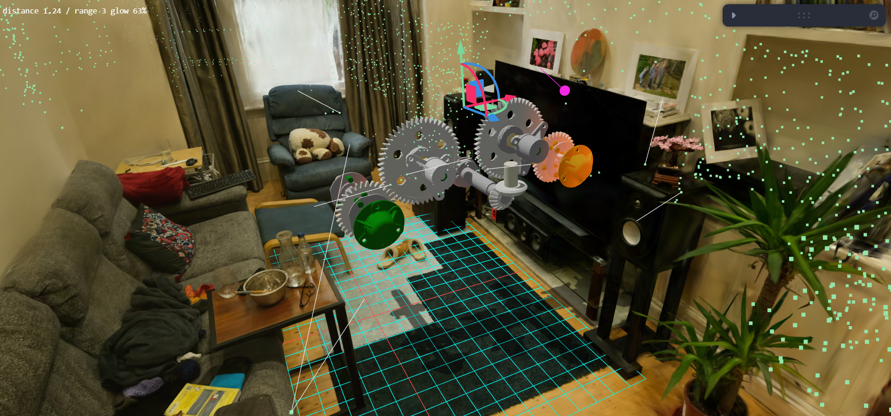

# Hybrid Digital Twin

A Gaussian-splat room with a CAD gearbox placed inside it. Built with React, Three.js, React Three Fiber
(`@react-three/fiber` + `@react-three/drei`), Tailwind CSS and Vite.


- **Phase 1 – Hybrid rendering:** a `.splat` environment and a `.glb` CAD mesh in one Three.js scene.
- **Phase 2 – Depth sync:** the mesh is occluded by splats in front of it, and casts/receives shadows.
- **Phase 3 – Proximity & logic:** the mesh glows as it nears dense parts of the splat; its transform
  can be saved and restored through `SceneStateSerializer`.



## Run

```bash
npm install
npm run dev
```

Open the URL Vite prints (http://localhost:5173). The first load is slow: `room.splat` is ~48 MB and the
distance field is built once after it loads (a few seconds). `npm run build` creates a production build.

Assets are in `public/`: `room.splat` (sample room) and `GearboxAssy.glb` (sample gearbox). To use your own,
replace those files (or change `SPLAT_URL` / `MODEL_URL` at the top of `src/App.tsx`) and re-align with the
controls below. A `.ply` splat has to be converted to `.splat` first.

## Controls (panel, top right)

| Panel | What it does |
|---|---|
| Model | Position, rotation, scale of the CAD mesh. A pivot gizmo in the scene moves/rotates it too. |
| Proximity | Glow `range` and colour. `showDense` draws the dense splat points, the lines used to measure distance, and the nearest point. |
| Floor | Height, size and x/z offset of the shadow plane; `showShadowPlane` shows where it is; `showGrid` shows a floor grid for alignment. |
| Light | Directional light position, rotation, intensity; `autoFitShadow` sizes the shadow camera to the model. |
| State | Save / load the mesh state (`localStorage`). The saved state is also restored on startup. |
| Preset | `Copy preset` copies the current values as JSON. Paste them into `PRESET` in `src/App.tsx` to make them the default. |

The splat's own alignment (offset, scale, rotation) is fixed in `PRESET.splat`.

## Project layout

- `src/App.tsx` – scene, controls, depth-sync setup, shadows, proximity shader patch, per-frame uniform updates.
- `src/proximity.ts` – reads the `.splat` file, finds dense areas, builds the 3D distance field.
- `src/sceneState.ts` – `SceneStateSerializer`.

## Architectural Decisions

### Depth-buffer synchronization
Splat renderers draw thousands of sorted, alpha-blended quads, and the splats cannot write a meaningful
depth buffer (a quad's depth is its centre, and blended pixels have no single depth). Instead of trying to
make the splats write depth, the scene relies on draw order and the depth test:

1. The CAD mesh is opaque, so it is drawn first and writes depth.
2. The splat is drawn afterwards as transparent geometry with `depthTest = true` and `depthWrite = false`
   (set explicitly in `Scene`, so it does not depend on library defaults).
3. A splat pixel in front of the mesh passes the depth test and blends over it (the mesh is occluded);
   a splat pixel behind the mesh fails the test (no bleed-through).

This needs no extra render pass or depth texture. The trade-off: occlusion is per splat quad (centre depth),
so a very large splat that straddles the mesh surface can still show a soft edge.

### Shadows
The splat has no real geometry, so it cannot receive shadows. A transparent `ShadowMaterial` plane is placed at
the splat's floor height; the mesh casts onto it, and the mesh also receives its own shadows. The plane draws
after the splat so the floor splats do not paint over it. The light's shadow camera is resized every frame to
cover the whole model, because a fixed orthographic box cut the shadow off when the light was off-centre.

### Spatial indexing for proximity
"Dense" is decided by a voxel grid over the splat points: a 0.2-unit cell counts as dense when it holds at
least 8 opaque splats (this removes floaters and sparse haze). The dense cell centres are then turned into a
**3D distance field** (exact Euclidean distance transform, one axis at a time) stored in a
half-float 3D texture. The shader samples that texture per pixel at the pixel's position, converted into splat
space with a uniform matrix. Reasons for this choice over a nearest-neighbour search per frame:

- The lookup is O(1) per pixel on the GPU, so the cost does not grow with the number of splats.
- The glow follows the real mesh surface and changes smoothly. An earlier version used one nearest point for
  the whole mesh and the lit faces jumped when the nearest point switched.
- The field lives in splat space, so the splat can be re-aligned without rebuilding it.

The distance data reaches the shader as uniforms (`uField`, `uFieldMin`, `uFieldSize`, `uSplatInv`,
`uSplatScale`, `uRange`, `uGlowColor`). The mesh materials are patched with `onBeforeCompile`, so they keep
their original look and lighting, and the glow is added on top.

### State persistence
`SceneStateSerializer` saves position, rotation (radians) and scale as a JSON string under one `localStorage`
key, and restores them with validation (returns `false` if the data is missing or invalid).

## Bottlenecks Handled

- **Memory.** The splat file is parsed once with a `DataView` straight from the `ArrayBuffer` and voxelised in a
  `Map`; only the dense cell centres (about 7k points from ~1.6M splats) are kept. The distance field is a
  half-float, single-channel texture (about 0.8 MB for a ~33×81×145 grid), not a float RGBA volume. Distances
  are capped at 8 units. Stray outer splats are excluded from the grid bounds (outer 1% on each axis).
- **UI / frame time.** Sorting of the splats is done by the splat renderer in a worker. Proximity is computed on
  the GPU from a precomputed texture, so no per-frame search over splats is needed for the glow. Uniforms and
  the shadow camera are updated inside `useFrame` (no React re-render per frame), with pre-allocated vectors and
  matrices; the splat matrix is built once because the splat alignment is fixed. The debug overlays only draw
  when `showDense` is on. Dragging the pivot writes straight into the panel values instead of recreating
  objects.
- **Load time.** The field is built after the splat is on screen, so the scene is usable while it is computed.
  The splat is fetched twice (renderer + dense-point pass); the second fetch is served from the browser cache.

## Known limitations

- The splat is an image-based representation, not solid geometry: proximity is a density-based estimate, not an
  exact clearance measurement, and the splat itself does not receive shadows or reflections.
- The `distance … glow …%` text and the `showDense` lines use a nine-point estimate (bounding-box centre and
  corners) on the CPU, so they can differ slightly from the per-pixel glow.
- The dense points are sparse on large flat surfaces (e.g. the wooden floor), so glow reacts more to furniture
  and walls than to the floor. Lowering `MIN_SPLATS` in `src/proximity.ts` makes the floor count more but adds noise.
- The first load is slow (48 MB sample splat).
